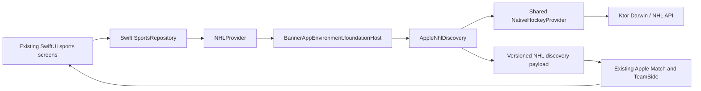

# BannerTV architecture

The Gradle root contains the existing Android applications and the shared Kotlin foundation. The complete Apple project lives under `apple/`. Its SwiftUI app, AVPlayer controller, CarPlay scenes, extensions, entitlements, native test targets and reference packages keep their original relative layout.

| Directory | Responsibility |
| --- | --- |
| `shared/src/commonMain` | Sports providers, canonical domain models, Game Centre reducers, fantasy rules, odds, news ranking, TMDB, Stremio protocol and media-library rules |
| `shared/src/jvmMain` | JVM filesystem, time and platform adapters used by Android |
| `shared/src/appleMain` | Darwin transport, platform implementations and the application-scoped `AppleFoundation`. The existing iOS implementations now serve the supported Apple targets |
| `core`, `mobile`, `app` | Existing Android platform services, Compose phone and Compose Fire TV applications. Media3 owns Android playback |
| `apple/MyApp` | SwiftUI, Apple presentation models and state, player, OS lifecycle, CarPlay, intents, notifications and platform storage |
| `apple/BannerSharedKit`, `apple/BannerLiveActivity` | Original native shared framework and Live Activity extension |
| `contracts/nhl` | Shared discovery payload and links to real Apple provider fixtures |
| `.github/workflows` | Android regression and Apple framework, app, fixture and live-integration gates |

The Apple import is pinned to `e4946252ffd7e5bb78145069cd819e81b985286f`. All 2,476 tracked paths at that revision were accounted for. The original history contains account signing material and historical Xcode user state. The new repository uses a sanitized snapshot, and the original repository retains the full history. [Pinned Apple source](https://github.com/alexdiabmusic-stack/StadiaTV-iOS/tree/e4946252ffd7e5bb78145069cd819e81b985286f)

The Android import came from the active local project. The separate `StadiaTV` GitHub repository and the developer's local Apple feature branch were not used as substitutes for the requested sources. Historical Android foundation verification records are under `shared/`.

## First shared application route

This route is selected by the `BANNER_KMP_ENABLED=YES` build setting. The default configuration retains the native route until Xcode integration and compatibility pass. An injected Swift NHL client continues to serve existing provider tests. Other league providers, detailed NHL play-by-play and game enrichment currently retain their native owners.

KMP owns NHL discovery transport, response interpretation, identities and provider caching on the selected route. The Swift repository's existing caller-requested scoreboard freshness/coalescing remains outside that boundary. The adapter translates qualified Kotlin IDs to the numeric IDs, canonical strings and asset URLs expected by existing Apple screens. It does not write to saved preferences.

## Configuration and credential ownership

Run `python3 scripts/bootstrap-public-sports.py` once in a clean checkout. It reads only the two pinned public NFL/PGA configuration files, checks their hashes, and writes ignored web-client defaults used by Gradle and Xcode. An offline setup can supply `--reference /path/to/pinned/apple/checkout`. Gradle generates its constants under the build directory. The preexisting provider requests keep their public client parameters. Private account credentials are separate.

Podcast Index request signing now reads a device Keychain record. Its service is `com.alexdiab.BannerTV.podcast-index`, account `signing`, with JSON string fields `key` and `secret`. Debug builds can read `PODCAST_INDEX_KEY` and `PODCAST_INDEX_SECRET` from the launch environment when there is no record. Missing configuration produces an authentication error. Locked or corrupt records produce errors. Production signed Podcast Index discovery requires owner-provisioned credentials before rollout. RSS playback and the other platform stores retain their existing implementations.

Xtream and fantasy Keychain services, bundle IDs, app groups, entitlements, existing UserDefaults keys and signing settings retain their original identities. Existing Apple iCloud preferences and Android's selected backup file remain separate persistence mechanisms. Shared business logic alone does not move data between devices.
