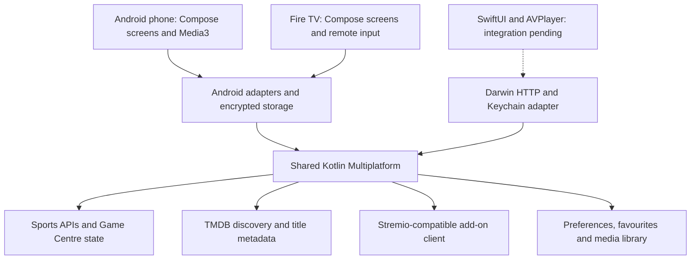

# Banner TV foundation: what is included

This foundation separates reusable product logic from each platform's interface, player and operating-system integrations. Android phone and Fire TV already consume the shared JVM artifact through `core`. Kotlin/Native targets and Apple adapters exist, but the Swift application has not yet been switched to the new framework or verified in Xcode.

## Architecture and ownership

| Layer | Included now | Still platform-owned |
| --- | --- | --- |
| `shared/commonMain` | Sports domain models, provider clients, mapping/reconciliation, caches, fantasy, odds, news selection/ranking, TMDB, Stremio protocol, favourites/settings models, media watchlist/progress rules | Native UI, media decoding, secure storage primitives, OS lifecycle |
| `shared/jvmMain` | JVM time, filesystem, locking and compatibility adapters | Android framework services |
| `shared/iosMain` | Foundation time/filesystem/locking, Ktor/Darwin networking, Apple service assembly, cancellable sports callbacks | Swift presentation-model adapters, native UI routing, player integration |
| `core` | Android app service graph, HTTP, encrypted vaults, existing IPTV/EPG/channel matching and playback services | Its playlist/XMLTV parsers and guide pipeline are not yet fully shared |
| `mobile` | Existing sports app plus the new cinematic Movies & Shows flow and media backup integration | Touch UI, Media3 player, Android lifecycle, cloud document picker |
| `app` | Existing Fire TV app consuming the shared sports services | TV layout, focus/navigation and player; new movie discovery UI is not yet ported here |
| `apple` | Keychain source, Info.plist fragment and framework integration instructions | Xcode linking and native verification remain outstanding |

## Sports services

These are working provider implementations moved into shared code. Their existing identities, cache schemas and sport-specific behavior were retained. Capability differences remain explicit; an unsupported request does not silently turn a native ID into an unrelated ESPN ID.

| Provider | Included behavior |
| --- | --- |
| NHL | Scores, schedules, teams, standings, rosters/players, landing pages, boxscores, play-by-play, scoring/penalty events, game-state reconciliation and snapshots |
| MLB StatsAPI | Schedule and scores, live game feed, boxscore and plays, inning/outs/base/count context, highlights, win probability and cached extras |
| NFL | Token/configuration requests, Shield policies, season/week calendar, game summaries, drives/plays, rosters/profiles and cached game recovery |
| NBA and WNBA | Separate league clients and identifiers, schedules, CDN/stat feeds, boxscores, play-by-play, league-specific periods/overtime and retained state |
| Premier League | SDP transport, schedule/teams, verified match mapping, lineups, events, statistics, commentary and recovery |
| MLS | Sportec fixtures, schedule cache, lineups, commentary/events and retained match state |
| LaLiga | Official API plus FotMob enrichment/ticker, verified cross-provider mappings, cooldowns, source-authority rules and reconciliation |
| Champions League | FotMob competition 42 scores/calendar, teams and standings. Unsupported detail/player capabilities remain explicit |
| CFL | Echo/PIMS fixtures, seasons, teams, standings, rosters and records, plus leaders. Fixture detail has a narrower scope than the full NFL Game Centre. CFL remains outside the normal league picker until stream matching is verified |
| Formula 1 | Jolpica calendar/results, SignalR protocol, compressed live timing, timing reducer, session identity, archives/replay and retry/authentication-stop policy. Socket implementations are platform adapters |
| PGA | GraphQL queries, compressed response decoding, tournaments, fields, leaderboards, scorecards and golfer models |
| ESPN | Fallback scores/schedules, teams, standings, rosters, athletes, news and summaries, subject to identity/capability checks |

Other shared sports features include ESPN Fantasy, Sleeper, local fantasy draft/lineup/scoring rules, player-pool and fixture association, MoneyLine odds mapping, RSS feed catalogs, news relevance/ranking, team podcast search/ranking, favourite-team identities and preference models. XML decoding for RSS remains a host adapter.

The shared network contracts support bounded responses, caching, request coalescing, cancellation, retry/cooldown policies and malformed-response rejection. Provider-specific reducers preserve usable state across partial or late updates. Offline regression fixtures exercise those behaviors; they do not guarantee uninterrupted upstream availability or eliminate stream buffering.

## Movies and series: TMDB

The shared TMDB layer now supplies:

- Typed movie versus series IDs, paginated multi-search, popular movies/series and weekly trending rows.
- A discovery model with independently loaded rows, partial-failure handling and a small featured selection.
- Posters, backdrops, title logos, cast portraits and episode stills, using sizes returned by TMDB configuration.
- Language-aware logo selection, neutral artwork fallback and text/image placeholders when assets are absent.
- Genres, overview, runtime, release year, series date ranges/production status, directors, writers, creators, cast/roles and recommendations.
- Seasons, specials and episodes with runtime, air date, description and artwork.
- Verified IMDb external identifiers for add-on lookup. TMDB's own numeric ID is never sent as an IMDb identity.

TMDB's `vote_average` is displayed as **TMDB**, not IMDb. An IMDb ID links identities but does not provide an IMDb rating. Metadata does not establish that a title can be streamed.

The Android phone implementation follows the supplied image references with a near-black media surface, artwork-led featured pager, title logos, white primary actions, compact metadata, 2:3 poster rows, portrait cast rows and episode cards. It provides:

1. Discover → Movies & Shows.
2. Featured title → details, or popular/trending row → full paginated grid.
3. Movie/series search and a saved **My list**.
4. Movie Play / series episode selection → enabled add-on sources → playback.
5. Retry a failed stream or return to choose another source.
6. Continue Watching with real saved progress and remaining time; completed items leave the resume row.

Sports Home remains dedicated to followed games and sports. The existing bottom navigation remains the app's navigation rather than being replaced by the reference app's tabs. There is no automatic carousel animation. TV-specific movie UI and SwiftUI counterparts remain follow-up work; shared data/models are available for both.

## Add-ons and playback

Users can connect a preconfigured HTTPS AIOStreams or other Stremio-compatible manifest URL. Banner TV does not require them to run a server. No hosted service was deployed.

- Add, validate, edit, enable/disable, check and remove multiple configured add-ons.
- Treat two configurations of the same add-on as separate connections.
- Support compatible catalog, metadata, stream and subtitle resources, including required catalog extras.
- Open the add-on's existing configuration page.
- Preserve configuration path/query values and securely store connection URLs.
- Support public, LAN/private and self-hosted HTTPS instances with valid TLS certificates.
- Resolve a movie/episode through enabled add-ons with bounded concurrency and timeouts; retain other providers' results when one fails.
- Play direct HTTPS streams and compatible subtitles using the Android player. Request credentials are scoped to the stream origin.

Torrent-only, external-player-only, response-rewriting and non-HTTPS streams are outside the implemented playback contract. AIOStreams server code was not embedded or copied; this is a provider-independent protocol client.

## Library, security and backup

Shared models hold watchlists, movie/episode identities, progress, completion and merge rules. Android persists them locally. Cloud-file export/import now includes media library metadata; the newest progress wins during merge. Stream URLs, add-on credentials and metadata tokens are excluded.

Android add-on and TMDB credentials use AES-GCM with Android Keystore, stored in atomic files under `noBackupFilesDir`. A locked or failed vault is not silently treated as a new empty library. Apple has a supplied Keychain adapter, pending native integration tests.

The supplied TMDB token passed live checks against configuration, popular movies, popular series and enriched movie details. It remains in ignored local settings for developer-side checks. **No token is compiled into source, resources or APKs.** On a development device, use Movies & Shows → Set up metadata · Development to validate and store the read token at runtime. This is a development provisioning step, not the intended public onboarding flow. Production credential provisioning is still an integration decision; no backend was created for it.

Synchronization is the requested user-selected cloud-backup file approach. There is no new login system, real-time account synchronization or hosted account database. Existing Android playlist, guide, casting, widgets and platform features remain in their host modules; their presence in the app does not imply they have all moved into common Kotlin.

## Verification and remaining gates

See [the verification record](VERIFICATION.md) for the preceding foundation build and [the cinema implementation record](CINEMA_QA.md) for this change. Build checks and unit tests are separate from visual/device QA. Device/emulator testing remains deferred at the user's request; full Xcode and its iOS SDK are unavailable.

Remaining major work includes Swift framework linking and host adaptation, native iOS/TV movie screens, real-device streaming/gesture/accessibility checks, production metadata credential provisioning, and the remaining shared IPTV/XMLTV/EPG/cloud-file migration.

## Official references used

- [TMDB image languages and fallbacks](https://developer.themoviedb.org/docs/image-languages), [movie details](https://developer.themoviedb.org/reference/movie-details), [series details](https://developer.themoviedb.org/reference/tv-series-details).
- [TMDB attribution requirements](https://developer.themoviedb.org/docs/faq) and [approved logos](https://www.themoviedb.org/about/logos-attribution). The approved SVG is bundled unchanged in the phone app's credits assets.
- [Compose accessibility defaults](https://developer.android.com/develop/ui/compose/accessibility/api-defaults): native control semantics, explicit labels and 48dp interaction targets inform the implementation. Device accessibility testing is still required.
