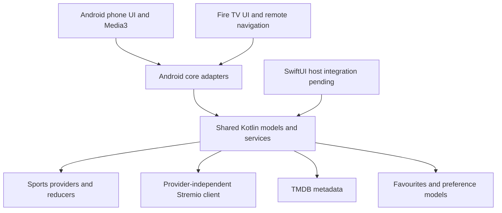

# BannerTV shared foundation

This module owns portable business logic and provider clients. Android phone and Fire TV consume its JVM artifact through `core`. iOS targets produce `BannerFoundation`; host linking and device verification are not complete yet. The existing native UIs and players remain platform code.

See [the detailed foundation breakdown](FOUNDATION_OVERVIEW.md) for feature ownership, the cinematic movie flow, credential provisioning and remaining integration work.

## Sports implementation

`SharedSports` assembles the same lazy provider graph for each platform. These are the existing implementations moved into `commonMain`, not placeholder interfaces or a second Android copy. Existing package names, saved identities, cache schemas, capability routing and provider-specific reducers are retained. `SportsBridge` adds cancellable, sanitized callback-based access for the Swift host; providers remain responsible for their own capabilities.

| Area | Shared implementation |
| --- | --- |
| NHL | NHL API scoreboards, schedules, teams, standings, player/roster data, landing/boxscore/play-by-play, events, situations, state reconciliation and disk snapshots |
| MLB | StatsAPI scores and schedule, live-feed/boxscore/plays, inning/base/count state, highlights, win probability and cached extras |
| NFL | NFL token/configuration handling, Shield request policies, season/week calendar, summaries, drives/plays, roster/profile data and snapshots |
| NBA / WNBA | Separate native clients, schedules and stats/CDN mapping, period/overtime rules, play-by-play, boxscores and retained state |
| Premier League | SDP transport, schedule/team data, lineups/events/stats/commentary, identity validation, polling and recovery |
| MLS | Sportec transport, fixtures, upcoming schedule cache, lineups, commentary, events and retained match state |
| LaLiga | Official API, FotMob enrichment/ticker, verified match mappings, cooldowns, source authority and reconciliation |
| Champions League | Explicit FotMob competition 42, scores, calendar, teams and standings; unsupported detail/player requests never reuse those IDs as ESPN IDs |
| CFL | Echo/PIMS fixture, season, team, standings, roster and record APIs; stats.cfl.ca leaders. Fixture detail is limited to data supplied by that endpoint; no invented drives or plays. Like iOS, CFL stays out of the league picker until watch matching is verified. |
| F1 | Jolpica calendar/results, SignalR framing, compressed telemetry, timing reducer, archive/replay state, session identity and retry policy. Android socket is OkHttp; the Apple adapter uses Ktor/Darwin. |
| PGA | Tour GraphQL queries, gzip decoding, tournament/field/leaderboard/scorecard and golfer models |
| ESPN | Fallback scoreboards, schedules, teams, standings, rosters, athletes, news and summaries. Fallback does not reinterpret a native game/team/player identity. |
| Fantasy | ESPN Fantasy, Sleeper, local draft/lineup/scoring logic, player-pool policy, fixture association and roster contexts |
| Other sports services | MoneyLine odds mapping, news feed catalog/relevance/ranking, team podcast search/ranking, followed-team identity and preferences |

Provider calls still depend on upstream availability. Passing offline fixtures establishes regression coverage, not a guarantee that every undocumented upstream endpoint will remain available.

## Module boundaries



- `commonMain`: domain models, HTTP contracts, native sports implementations, provider routing, portable caches, fantasy, news/ranking, preferences, add-ons and TMDB.
- `jvmMain`: existing calendar compatibility, JVM filesystem/locking and cache constructors accepted by the Android hosts.
- `iosMain`: Foundation calendar/filesystem/locking, Ktor/Darwin transport and `AppleFoundation` assembly.
- `core`: Android app lifetime, encrypted device storage, XML parsing, sockets, playlist/guide loading, scheduling, player and OS services. Playlist/XMLTV/EPG processing and cloud-file operations are **not yet fully migrated to commonMain**. They continue working through the existing Android code.
- `mobile`, `app`: existing UI, focus, accessibility and playback behavior. No promise of a lag-free network stream.

## Add-ons: Phase 1

Users connect an existing, preconfigured HTTPS Stremio manifest URL. They do not have to operate a server. Multiple configurations of the same add-on remain separate. URLs with public domains, private IPs, localhost and self-hosted domains are supported when their TLS certificate is valid; TLS verification is not disabled.

`AddonLibrary` validates the remote manifest before committing an add/edit; supports enable, disable, remove and connection checks; preserves configured path/query components; and opens the existing configuration interface. Catalog, metadata, stream and subtitle requests are checked against manifest capabilities. Direct HTTPS streams and request headers are supported. Torrent-only, external-player-only, response-rewriting and non-HTTPS resources are not represented as playable streams.

Android has a Movies & Shows entry under Discover. Configuration is encrypted with Android Keystore AES-GCM in `noBackupFilesDir`, independently of ordinary settings and cloud backup. The Apple Keychain adapter is supplied under `apple/` but has not been linked/tested in Xcode. Errors must not contain configured URLs or credentials. No hosted AIOStreams service, accounts backend or deployment was created.

The AIOStreams source was studied for route/resource compatibility; server implementation was not copied into the app. The integration is a Stremio protocol client so another compatible provider can be added without an AIOStreams-specific service layer.

## TMDB

`TmdbRepository` supplies movie/series search, popular and weekly trending discovery rows, rich details, localized title logos, cast/crew, recommendations, seasons/episodes and configured artwork sizes for posters, backdrops, logos, profiles and stills. Movie and TV IDs are different types even if their numeric value is identical. Only a verified `external_ids.imdb_id` may be translated into an IMDb-based Stremio video ID; episodic IDs include season and episode.

The Android phone now connects these models to a cinematic Movies & Shows destination, title details, source selection, watchlists and Continue Watching. `MediaPlaybackResolver` queries enabled add-ons with an overall deadline and preserves working streams when subtitle requests fail. Shared library/progress models contain no stream credentials; Android cloud-file backup includes this metadata. iOS and TV movie screens remain host work.

The host injects the read token from secure storage. No supplied TMDB token or key is embedded in this module or the APK. Android uses a separate encrypted runtime vault, with a development-only setup action; production provisioning remains host work. The metadata service is not a playback source. Android phone credits now include the approved TMDB logo and this notice; other hosts must include them when enabling metadata UI:

> This product uses the TMDB API but is not endorsed or certified by TMDB.

## Verification

The latest November 1, 2026 verification passed common metadata compilation, all four unit-test tasks and both Android debug assemblies: **925 passed, 0 failed, 5 skipped**. See [the cinema verification record](CINEMA_QA.md) for the current results and [the initial foundation record](VERIFICATION.md) for the preceding baseline. Both records distinguish automated checks from the outstanding device and iOS gates.

Run from the repository root, with the existing JDK and Android SDK configured:

```sh
./gradlew --no-watch-fs :shared:compileCommonMainKotlinMetadata :shared:jvmTest :core:testDebugUnitTest :mobile:testDebugUnitTest :app:testDebugUnitTest --max-workers=1 --no-parallel -PpublicBuild=true
./gradlew --no-watch-fs :mobile:assembleDebug :app:assembleDebug --max-workers=1 --no-parallel -PpublicBuild=true
```

The shared JVM suite includes existing iOS-derived sports fixtures and new add-on, time, metadata, HTTP and CFL tests. Common tests can also run on the Apple target after installing Xcode. Device/emulator QA is deferred per the user's instruction. See `apple/README.md` for the native integration gate; common metadata compilation alone cannot establish iOS runtime parity.

## Reference baseline

- [StadiaTV-iOS main reference](https://github.com/alexdiabmusic-stack/StadiaTV-iOS/tree/e4946252ffd7e5bb78145069cd819e81b985286f/MyApp)
- [StadiaTV Android reference](https://github.com/alexdiabmusic-stack/StadiaTV/tree/a81771a64cb706ce38cdf9fd144b8e9e62333655/Firestick-Android-TV)
- [Stremio manifest protocol](https://github.com/Stremio/stremio-addon-sdk/blob/master/docs/api/responses/manifest.md)
- [TMDB application authentication](https://developer.themoviedb.org/docs/authentication-application), [images](https://developer.themoviedb.org/docs/image-basics), [attribution](https://developer.themoviedb.org/docs/faq)
- [Kotlin direct integration with Xcode](https://www.jetbrains.com/help/kotlin-multiplatform-dev/multiplatform-direct-integration.html)
- [Ktor response streaming](https://ktor.io/docs/client-responses.html), [WebSockets](https://ktor.io/docs/client-websockets.html), [Darwin engine](https://ktor.io/docs/client-engines.html#darwin)
